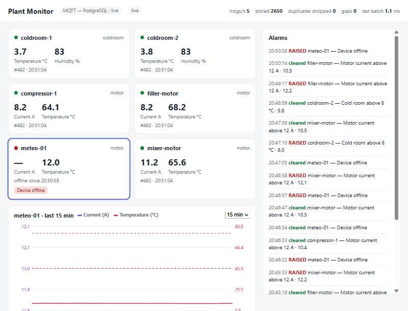

# ESP32 weather station firmware that doesn't lose readings

Firmware for an ESP32 + BME280 station that publishes over MQTT to the
[plant monitor](../../Upwork/Electrónica%20y%20embebidos/MQTT%20IoT%20Panel) (sensors → broker → PostgreSQL → live
panel). The panel side already survives broker restarts and duplicates. This is the **device side**:
what an ESP32 has to do so that Wi-Fi drops, broker hiccups and lost packets don't leave holes in
the data.



*The panel during an 8 s link cut injected by the bridge: the broker published the station's last will,
so `meteo-01` shows as offline. When the link came back it sent what it had sampled meanwhile, and the
panel's gap counter stayed at 0. (The panel only knows "coldroom" and "motor" devices, hence the empty
"Current A" for a weather station.)*

## Result

The firmware logic, compiled for the PC, against the real panel (Aedes broker + ingest + PostgreSQL):
90 s at 2 readings/s, **two abrupt link cuts** (12 s and 6 s, no MQTT DISCONNECT) and **5 % of
messages lost** after leaving the device (`node host/e2e.mjs`):

| | |
|---|---|
| Readings sampled on the device | 176 |
| Stored in PostgreSQL | **176**: no gaps, no duplicates |
| Sent late, after reconnecting (store and forward) | 37 |
| Lost by the network → requested again by the panel → resent | 7 → 6 requests → 7 |
| Offline alarms (last will) | 2 raised, 2 cleared |

**Firmware build** (`pio run`, Arduino-ESP32 on espressif32 8.0.0): RAM 20.1 % (65.9 KB), flash 72.2 %,
no warnings. **19 unit tests** of the core on the PC (Unity, `-Wall -Wextra -Werror`).

**Not yet run on a physical board**: no ESP32 + BME280 was connected while writing this. The core is
the same code in the firmware and in the PC build, and the firmware compiles; what remains unverified
is the glue in `src/main.cpp` (Wi-Fi, PubSubClient, BME280, NTP). Checklist for the first flash at the
end.

## How it works

```
sensorTask (core 1, every 2 s)         BME280 ─► spike filter (median of 3, datasheet limits) ─► queue
loop task                              Wi-Fi + MQTT with exponential backoff and jitter
                                       queue ─► Station::on_sample()  (assigns boot/seq, stores in a 512-slot ring)
                                       Station::loop()                (backlog oldest first, then resends; 20 per pass)
                                       PubSubClient                   QoS 0 publish, last will "offline", subscribed to resend
task watchdog                          a task that doesn't check in for 30 s reboots the board
```

`lib/station_core/` holds every decision: numbering, the ring, store and forward, resend, payload
encoding, parsing, backoff and filtering. It is plain C++17 with no Arduino, so it is unit tested on
the PC and the same sources run in `host/station_host`, which the end-to-end test drives.
`src/main.cpp` is only the ESP32 glue.

## Decisions worth explaining

**QoS 0 on purpose, made reliable by the protocol.** PubSubClient, the de facto Arduino MQTT client,
can only publish at QoS 0. Instead of switching libraries, the station uses the panel's protocol:
every reading carries `(boot, seq)`, the server sees a jump from 41 to 43 and publishes
`plant/<id>/resend {"boot":…,"from":42,"to":42}`, and the station answers from its ring. That also covers
the case QoS 1 doesn't: a broker that acknowledges a message and dies before forwarding it.

**`boot` is the epoch time of the power-up, so the station waits for NTP before sampling.** The server
orders power-ups by `boot`, so a random id would sometimes make a new power-up look older than the
previous one and its readings would be discarded as late. Until the clock is set, the station just
keeps the watchdog fed.

**Backlog strictly in order, live readings wait their turn.** After an outage, a new reading is not
published ahead of the backlog. That way the server sees seq go up monotonically and doesn't raise
false gaps (and resend requests) for readings that are simply still queued. 20 sends per loop pass
keep MQTT keepalives and the watchdog going while a long backlog drains.

**A ring in static memory, not a heap queue.** 512 readings × 24 B = 12 KB, sized at link time: no
fragmentation after weeks of uptime, and an outage longer than ~17 minutes loses the oldest readings
on purpose (counted in `lost_overwritten`) instead of running out of memory.

**Resend requests are merged and checked.** The panel repeats its requests every 2 s until the gap
closes. Overlapping or adjacent ranges are merged, requests for another boot or for readings not yet
taken are ignored, and readings no longer in the ring are counted as unavailable (the panel gives
up after 10 tries).

**Rejected values are `null`, not 0.** A disconnected sensor that reads 0 °C would raise a false frost
alarm. Values outside the BME280 operating range become NaN and go out as JSON `null`. A single bad I2C
read is removed by a median of 3 without lagging real changes by more than one sample.

**Exponential backoff with jitter.** 1 s, 2 s, 4 s… up to 60 s, ±20 %, so a building full of stations
doesn't hit the broker in lockstep when the power comes back.

## Run it

**Firmware** (PlatformIO):

```
cp include/config.example.h include/config.h     # Wi-Fi, broker IP, device id
pio run -e esp32dev -t upload
pio device monitor
```

Wiring: BME280 VIN → 3V3, GND → GND, SDA → GPIO 21, SCL → GPIO 22 (address 0x76; 0x77 if SDO is
high). With no sensor it publishes simulated readings (`SIMULATE_IF_NO_SENSOR`), handy to test the
link first.

**Tests and the PC build**:

```
pio test -e native                  # Linux/macOS/CI (gcc)
python tools/test_native.py --host  # Windows without gcc: uses g++/clang or `pip install ziglang`
```

**End to end** (needs the plant monitor and PostgreSQL):

```
createdb station_demo
node host/run-panel.mjs                         # broker :1883, panel :8080, its own database
cd host && npm install && node e2e.mjs          # 90 s with cuts and loss, then checks PostgreSQL
node bridge.mjs --duration 600 --cut 60:20      # just run the station against the panel
```

## First flash checklist

- [ ] Serial log shows `BME280 found` and `clock set, boot id …` (NTP reachable).
- [ ] `meteo-01` appears in the panel with plausible temperature and humidity.
- [ ] Unplug the router for a minute: the panel shows *offline* about 20 s later (1.5 × keepalive) and,
      once the router is back, `late` in the minute log matches the readings missed, with no gaps in the panel.
- [ ] Unplug the BME280: readings go out as `null`, the firmware keeps running, nothing reboots.
- [ ] Leave it a day: `heap` in the log stays flat.

## Files

| | |
|---|---|
| `lib/station_core/src/station.*` | numbering, store and forward, resend |
| `lib/station_core/src/protocol.*` | payloads, ISO 8601 timestamps, resend parser, topics |
| `lib/station_core/src/ring_buffer.h` | static history indexed by seq |
| `lib/station_core/src/sensor_logic.h` | limits, spike filter, backoff, simulated sensor |
| `src/main.cpp` | ESP32 glue: FreeRTOS task, Wi-Fi, PubSubClient, BME280, NTP, watchdog |
| `test/test_core/test_main.cpp` | 19 Unity tests |
| `host/` | PC build, MQTT bridge with fault injection, end-to-end test |
| `tools/no_map_on_non_ascii_path.py` | works around the ESP32 linker failing on paths like `Estación` |
